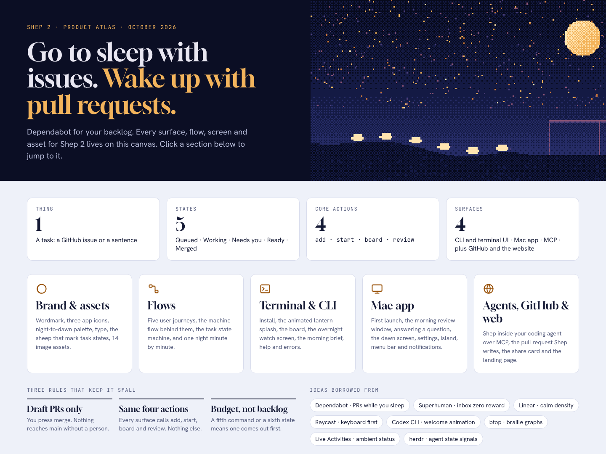

# Shep 2: design handover

Everything produced while designing Shep 2 (spec 151), saved in one place: the product
story, decisions, the full design atlas (32 boards), image assets, and the open questions.

> **One line:** Go to sleep with issues. Wake up with pull requests.
> **Pitch:** Dependabot for your backlog.

## Contents

| Folder | What's inside |
| ------ | ------------- |
| [`video/`](video/) | **A 4-minute narrated overview video**: the product, how you work with it, onboarding, look and feel. Start here. |
| [`screens/`](screens/) | A PNG of every atlas board, rendered at full size |
| [`atlas/`](atlas/) | Source of the design canvas: `canvas.json` (pages and layout) and one `.dc.html` per board |
| [`atlas/assets/`](atlas/assets/) | Generated images: 7 sky frames, dawn/night heroes, share-card background, sidebar sky, 3 app icons, 2 contact sheets |
| [`pages/`](pages/) | The three standalone pages (HTML + full-page PNG): the story, the product preview, design directions |
| [`tools/make_assets.py`](tools/make_assets.py) | Regenerates every image in `atlas/assets/` (Python + Pillow) |

Live versions (private to the owner's claude.ai account):

| Page | Link |
| ---- | ---- |
| Product atlas (design canvas) | https://claude.ai/artifact/UsmG8gjEiEKbRh6BVWJDmj |
| The Night Shift (story) | https://claude.ai/artifact/2DEqQ2QXMGgH1LeTc55g9J |
| Shep 2 Preview | https://claude.ai/artifact/WD6xmHZCDv1cB1y6BUt17u |
| Design Directions (research) | https://claude.ai/artifact/Rkyr9UKabLmK7drNgNMEdk |

## The story in 30 seconds

Read [`pages/shep-night-shift.png`](pages/shep-night-shift.png) for the full version.

- Shep 1 grew to 56 command groups and ~346K lines. Downloads peaked at 59K/month in March 2026
  (one broadcast moment) and settled near 7.6K. Every surface told a different story.
- Running parallel agents in worktrees is now offered by Conductor, Codex, Cursor, Claude Code,
  GitHub Agent HQ, Amp and herdr. All of them are built for watching an agent work.
- **The gap:** nobody is built for coming back. Shep 2 is the night shift: hand it tasks in the
  evening; in the morning review draft PRs that already pass CI, with proof, and press Merge or
  Send back.

## How the Hit Makers lens shaped it

| Idea (Derek Thompson, *Hit Makers*) | What it means for Shep 2 |
| ----------------------------------- | ------------------------ |
| Familiar + one surprise (MAYA) | Familiar: assigning a ticket, a PR, a review. Surprise: it's done by morning. |
| One line, repeated everywhere | "Go to sleep with issues. Wake up with pull requests." on every surface |
| Audience of your audience | A Shep reply in a shared Slack thread or ticket shows Shep to the whole team |
| Behavioral, not aspirational, self | Hand work over the way people already do (assign, label, react), not a new ritual |
| Steakhouse, not diner | A small fixed menu: 1 thing, 5 states, 4 actions, 4 surfaces |
| Protect the making phase | Overnight, unattended; you only see finished work |

## The product contract

| Budget | Value |
| ------ | ----- |
| Things | 1: a **task**, i.e. anything you'd hand a teammate, from wherever it lives |
| States | 5: Queued → Working → Needs you / Ready → Merged |
| Core actions | 4: add, start, board, review |
| Surfaces | 4: CLI, terminal UI, Mac app, MCP (plus GitHub and the website) |
| CLI commands | 4: `shep`, `shep add`, `shep go [--at]`, `shep config` |

Rules: Shep only opens draft PRs and a person presses Merge. Adding a command, state or
tool means removing one.

## Decisions made

| Question | Decision |
| -------- | -------- |
| v2 approach | All new: new CLI, MCP, terminal UI, Mac app, design. Shep 1 freezes at 1.x. |
| Name | Keep **Shep** |
| Imagery | Keep sheep, made distinct from herdr: sheep are *tasks walking into the pen at dawn* (progress), never agents in a pasture |
| Signature visual | **The sky is the progress bar**: night → dawn as tasks finish. Lantern brand mark, dithered 8-color palette, ASCII scene in the terminal |
| Type | Gloock (display), Hanken Grotesk (UI), JetBrains Mono (code) |
| Platform | Mac-first, native SwiftUI (Dynamic Island, Live Activities, App Intents, actionable notifications). CLI, terminal UI and MCP also run on Linux. |
| Core language | Rust single binary (daemon, CLI, Ratatui + tachyonfx terminal UI, rmcp MCP), JSON-RPC over a local socket with an OpenRPC schema. No C++. A 5-day spike decides: if Rust takes >1.5x the Bun time, use TypeScript on Bun + OpenTUI. |
| gpui | Not used: SwiftUI is the only way to reach the Mac system surfaces; gpui is pre-1.0 and Zed-shaped |
| herdr | Copy patterns (and Apache-2.0 code only from revisions after 2026-07-22, with attribution): OSC 7501 status, detection manifests, PTY holder separate from the daemon, resume hooks, attach/takeover, child review agent, "OpenRPC only grows" test. No runtime dependency. |
| Telemetry | PostHog key built in (shipped in [shep-ai/shep#953](https://github.com/shep-ai/shep/pull/953)) |

## Where work comes from: "Assign it to Shep"

Feedback: GitHub issues alone are too limiting. People should hand work to Shep the way they
already hand it to a teammate, in the tool where it lives, and get the answer back in the same
place. See [`screens/Sources.png`](screens/Sources.png),
[`screens/SignalThread.png`](screens/SignalThread.png) and
[`screens/OnboardingSources.png`](screens/OnboardingSources.png).

| Tool | Hand it over | By morning |
| ---- | ------------ | ---------- |
| Linear | Label `shep` or status Tonight | Draft PR linked, proof comment, status In review |
| Jira | Move to a Tonight column | PR and build status on the issue, moves to Review |
| Notion | Status Tonight in a tasks database | PR link and screenshot on the page |
| Monday | Status Tonight | PR link column filled, status In review |
| Slack | `:sheep:` reaction or "@Shep tonight" | Thread reply with PR, proof, Merge / Send back |
| GitHub | Label `shep` | Draft PR that closes the issue |

Onboarding now starts with **"Where do tasks come from today?"**, then connect, then the
hand-over moves, then "Good candidates for tonight" found across all sources.

### Does this need a server? No, for v2

The work happens overnight, so polling every few minutes is invisible to the user.

| Works with no server | Needs a server (later, optional) |
| -------------------- | -------------------------------- |
| Linear, Jira, Notion, Monday: personal token in the keychain, polled every few minutes; Shep comments and moves status as you | "Assign to Shep" as a real assignee (needs an app identity per tool, usually with webhooks) |
| GitHub through `gh` | A single shared Slack app listed in the Slack Marketplace |
| Slack in Socket Mode from the Mac, one Slack app per team created from a manifest | Anything while the Mac is off (not a goal) |

If a server is ever added, keep it a thin relay that forwards events to the Mac and stores
nothing.

> The boards still say "Assign the issue to Shep" in places. Treat label / status / reaction
> as the v2 moves and "assign to Shep" as a later upgrade.

## Board index

### Overview and brand
| Board | Image |
| ----- | ----- |
| Atlas overview | [Main.png](screens/Main.png) |
| Brand system | [Brand.png](screens/Brand.png) |
| Image assets | [Assets.png](screens/Assets.png) |

### Flows
| Board | Image |
| ----- | ----- |
| User flows | [UserFlows.png](screens/UserFlows.png) |
| Machine flow | [MachineFlow.png](screens/MachineFlow.png) |
| Task states | [TaskStates.png](screens/TaskStates.png) |
| One night, machine view | [Overnight.png](screens/Overnight.png) |
| Edge cases and error flows | [EdgeFlows.png](screens/EdgeFlows.png) |

### Terminal and CLI
| Board | Image |
| ----- | ----- |
| Install and first run | [Install.png](screens/Install.png) |
| Lantern splash (animated) | [Splash.png](screens/Splash.png) |
| Terminal board | [Board.png](screens/Board.png) |
| Watch screen (animated) | [Watch.png](screens/Watch.png) |
| Morning brief | [Brief.png](screens/Brief.png) |
| Four commands, help and errors | [CLI.png](screens/CLI.png) |
| Split view: tasks, live agent, diff, CI | [SplitView.png](screens/SplitView.png) |
| Terminal onboarding, every step | [TerminalOnboarding.png](screens/TerminalOnboarding.png) |

### Mac app
| Board | Image |
| ----- | ----- |
| First launch | [MacOnboarding.png](screens/MacOnboarding.png) |
| Onboarding, every step | [MacOnboardingFlow.png](screens/MacOnboardingFlow.png) |
| Morning review | [MacReview.png](screens/MacReview.png) |
| Needs you + diff | [MacNeedsYou.png](screens/MacNeedsYou.png) |
| Live working view | [MacWorking.png](screens/MacWorking.png) |
| Add tasks for tonight | [MacAddTask.png](screens/MacAddTask.png) |
| Dawn (queue clear) | [MacDawn.png](screens/MacDawn.png) |
| Settings | [MacSettings.png](screens/MacSettings.png) |
| Island, menu bar, notifications | [MacSystem.png](screens/MacSystem.png) |

### Agents, GitHub and the web
| Board | Image |
| ----- | ----- |
| MCP inside your agent | [MCP.png](screens/MCP.png) |
| The pull request Shep writes | [PullRequest.png](screens/PullRequest.png) |
| Morning share card | [ShareCard.png](screens/ShareCard.png) |
| shep.bot landing page | [Landing.png](screens/Landing.png) |

### Sources
| Board | Image |
| ----- | ----- |
| Assign it to Shep: every source | [Sources.png](screens/Sources.png) |
| A chat thread and a ticket, start to finish | [SignalThread.png](screens/SignalThread.png) |
| Onboarding: where does your work live? | [OnboardingSources.png](screens/OnboardingSources.png) |

## Open decisions

1. **Where v2 lives.** Recommendation: an orphan `next` branch in this repo (keeps stars,
   issues and history), merged into `main` at launch. Not created yet.
2. **npm name.** `npx shep` is taken by an unrelated package. Recommendation: reserve `shepai`
   now (`npx shepai`) and ask the owner of `shep` about a transfer. The CLI command stays `shep`
   either way. Spec 151 still lists this as open.
3. **Rust spike.** 5 days, same slice in Rust and in Bun, kill rule above.
4. **Spec 151 is behind the design.** It still describes a task as "a GitHub issue or a
   sentence", has no sources/adapters section, and lists "tmux-style pane splitting" as out of
   scope although the split view board was added. Update `spec.yaml` before planning.
5. **Older boards are GitHub-only.** Main, UserFlows, MachineFlow, TerminalOnboarding and
   MacOnboardingFlow predate the sources direction and should be folded into it.

## Working with the source files

- Each `atlas/*.dc.html` board loads `./support.js`, the design canvas runtime served by the
  live canvas. It isn't committed, so the boards render on the live canvas, not by opening the
  file directly. Use `screens/` to view them.
- Image paths in the committed boards point at `atlas/assets/`. The live canvas uses uploaded
  copies; [`atlas/assets/blob-map.txt`](atlas/assets/blob-map.txt) maps each upload id to its file.
- Regenerate the images: `python3 tools/make_assets.py atlas/assets` (needs Pillow).
